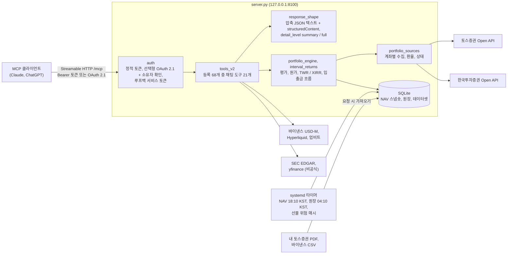

# K-invest

[English](README.md)

K-invest는 Claude나 ChatGPT 같은 AI 채팅 클라이언트가 내 증권·암호화폐 계좌에 대한 질문에 답할 수 있게 해 주는 읽기 전용
[MCP](https://modelcontextprotocol.io) 서버예요. 토스증권이나 한국투자증권(KIS) 계좌를 가진 국내 개인 투자자를 위한
것이에요. 보유 종목, 기간 수익률, 거래 내역, 실현 손익을 한곳에서 보여 줘요. 모든 숫자에는 출처와 기준 시각이 붙고,
데이터가 불완전하면 그 이유 코드도 함께 붙어요.

내 컴퓨터나 서버에서 내 API 키로 실행해요. 요청은 아래 표의 API로만 나가요.

## 데이터 출처

| 출처 | 접근 방식 | 용도 |
|---|---|---|
| 토스증권 Open API | 공식, 본인 client ID·secret | 계좌, 보유 종목, 예수금, 주문 내역, 시세, 캔들, 장 운영 일정, 환율 |
| 한국투자증권 Open API | 공식, 본인 app key·secret | 국내·해외 잔고, 예수금, 체결 내역, 시세 |
| SEC EDGAR | 공식, `SEC_USER_AGENT`에 연락처가 담긴 `User-Agent` | 미국 재무제표, TTM 수치, Form 4 내부자 거래 |
| [yfinance](https://github.com/ranaroussi/yfinance)를 통한 Yahoo Finance | **비공식** | 재무제표와 주요 지표, 배당 일정, 미국 10년물 국채 금리, 보조 환율. 값에 `yfinance` 출처가 표시돼요. |
| 바이낸스 USD-M 선물 API | 공식, 읽기 전용 API 키 | 선물 포지션, 잔고, 체결, 펀딩비. 공개 시세는 키 없이 조회해요. |
| Hyperliquid info API | 공식 공개 엔드포인트, 계정 주소만 필요 | 무기한 선물 포지션, 잔고, 체결, 펀딩비 |
| 업비트 공개 시세 | 공식 공개 엔드포인트 | 암호화폐 잔고 평가에 쓰는 USDT/USDC 원화 가격 |
| 내 파일 | 로컬 | 토스증권 PDF 거래내역서, 바이낸스 CSV 내보내기 파일 (요청할 때만 가져와요) |

웹사이트를 스크래핑하거나 로그인하지 않아요. 설정하지 않은 계좌는 미설정으로 표시되고, 나머지 도구는 그대로 동작해요.

## 도구

채팅 클라이언트에는 도구 21개가 보여요. 서버에 등록된 도구는 68개예요. 나머지 47개는 21개 도구로 합쳐진 예전의 세분화된
도구이고, 스크립트와 로컬 서비스에서는 계속 호출할 수 있어요.

| 도구 | 반환 내용 |
|---|---|
| `get_status` | 연결 상태: 캐시된 서비스 상태, 실시간 출처 점검, 설정된 계좌, 사용 안내 |
| `get_holdings` | 종목별로 합친 현재 보유 종목(원 통화와 원화 기준)과 예수금 |
| `get_portfolio_summary` | 전체 증권 계좌 합계를 섹션별로: 합계, 노출, 집중도, 실현 손익 |
| `get_portfolio_returns` | 기간 수익률: 단순 수익률·TWR·XIRR 비교, 손익 분해, NAV 위험 통계 |
| `get_transactions` | 토스증권과 한국투자증권 전 계좌의 거래를 최신순으로, 페이지 단위로 |
| `get_trading_pnl` | 계좌별 이동평균 원가 기준 실현 손익, 왕복 거래, 승률 |
| `get_quote` | 최대 10개 종목 시세 (토스증권, 실패 시 한국투자증권) |
| `get_candles` | 한 종목의 OHLCV 캔들 |
| `get_market_info` | 한국·미국 장 운영 시간과 휴장일, 환율, 미국 10년물 국채 금리 |
| `get_crypto_market` | 한 심볼의 바이낸스 USD-M 공개 시세 |
| `get_crypto_positions` | 암호화폐 선물 보유 포지션과 잔고 (바이낸스 USD-M, Hyperliquid) |
| `get_crypto_account_history` | 내 암호화폐 선물 체결 또는 펀딩비 내역, 페이지 단위 |
| `get_stock_snapshot` | 한 종목의 시세, 지표, 애널리스트 컨센서스, 내부자 데이터 |
| `get_financials`, `get_key_metrics` | yfinance 재무제표와 주요 지표 (미국, 한국, 일본) |
| `get_sec_financials`, `get_ttm_financials` | SEC 연간·분기 재무제표, TTM 수치 (미국) |
| `get_insider_trades` | SEC Form 4 내부자 거래 (미국) |
| `snapshot_portfolio_nav` | **로컬 쓰기.** 오늘의 NAV 스냅숏을 저장해요. 평소에는 18:10 KST 타이머가 저장해요. |
| `export_portfolio_dataset` | **로컬 쓰기.** 검증 가능한 포트폴리오 데이터 사본을 고정하고 페이지 단위로 돌려줘요 |
| `import_statement` | **로컬 쓰기.** 비공개 수신 폴더의 토스증권 PDF 거래내역서에서 매수·매도 행을 두 단계로 로컬 원장에 가져와요 |

수익률은 내가 저장한 데이터로 계산해요. 어떤 API도 알려 주지 않는 입금처럼 기록이 빠진 부분이 있으면, 이유 코드와 함께
그 사실을 밝히고 수치를 추정치로 표시해요.

## 구조



`deploy/`의 타이머는 서버 없이 `scripts/snapshot_nav.py`, `scripts/collect_ledger.py`,
`scripts/snapshot_futures_risk.py`를 실행해요. 두 날짜 사이의 수익률에는 각 날짜의 저장된 NAV가 필요해서, 매일 찍는
스냅숏이 있어야 기간 수익률을 계산할 수 있어요. 암호화폐 선물은 따로 보고하고 포트폴리오 NAV에는 넣지 않아요.

## 응답 크기 예산

모든 도구 결과에는 `structuredContent` 객체 하나와, 같은 객체를 압축 JSON으로 담은 텍스트 블록 하나가 들어 있어요
(MCP 2025-06-18). 그래서 모델에게 텍스트만 보여 주는 클라이언트(claude.ai)와 `structuredContent`를 읽는
클라이언트(ChatGPT)가 같은 필드를 봐요.

- 큰 포트폴리오 도구의 기본값은 `detail_level="summary"`예요. ID 목록, 일별 환율 표, 근거 블록은 `full`로 옮기고, 옮긴
  경로와 항목 수를 `meta.detail.omitted`에 적어요. 반복되는 메타데이터는 `shared` 아래에 한 번만 저장해요. 답에 필요한
  숫자와 빈 값의 이유 코드는 옮기지 않아요.
- `get_portfolio_summary`, `get_portfolio_returns`, `get_holdings`의 summary 기본 응답은 여러 계좌가 있는 테스트
  포트폴리오에서 27,000바이트 이하예요.
- 나머지 채팅 도구의 기본 응답은 모두 30 KiB 미만이에요. `get_transactions`와 `get_crypto_account_history`의 각
  페이지도 마찬가지예요. 한 페이지는 1–500행(기본 100행)이고, 인자나 기본 날짜 구간이 바뀌면 커서를 거부해요.
- `detail_level="full"`은 전체 객체를 돌려줘요.

이 한도는 `tests/test_merge_budget.py`, `tests/test_merge_paging.py`, `tests/test_route_returns_size.py`가 검사해요.

## 교차 클라이언트 회귀 검사

릴리스 전에 정해진 질문 19개를 같은 서버에 연결한 Claude와 ChatGPT에 각각 물어봐요. 각 답변은 근거가 되어야 할 도구
출력과 비교해 pass, partial, fail로 채점해요. 소유자의 채점 규칙에 따라 ChatGPT는 포트폴리오 데이터를 K-invest에서
가져오는 한 자체 내장 도구도 쓸 수 있어요.

최근 결과, 이번 릴리스 기준 (2026-10-22 21:14 KST, 클라이언트별 질문 19개):

| 클라이언트 | Pass | Partial | Fail |
|---|---:|---:|---:|
| Claude | 18 | 1 | 0 |
| ChatGPT | 16 | 3 | 0 |

오프라인 테스트는 두 클라이언트가 의존하는 응답 형식을 검사해요. 텍스트 블록은 `structuredContent`와 같아야 하고, 호출
전체가 실패하면 `isError`가 설정되어야 해요. 채팅 도구 목록, 설명, 스키마는 해시로 고정돼 있어요
(`tests/test_tx_wire.py`, `tests/test_merge_catalog.py`, `tests/test_tool_offloop.py`).

## 읽기 전용 안전성

- 주문, 취소, 이체, 출금 도구가 없고, 증권사나 거래소의 쓰기 엔드포인트를 부르는 코드도 없어요. POST 요청은 토스증권과
  한국투자증권의 OAuth 토큰 요청, Hyperliquid의 읽기 전용 `/info` 엔드포인트뿐이에요.
- 제공자가 읽기 전용 키를 지원하면 그 키를 쓰세요 (바이낸스는 거래·출금 권한 없이). Hyperliquid는 공개 주소만 있으면 돼요.
- 쓰기를 하는 도구는 `snapshot_portfolio_nav`, `export_portfolio_dataset`, `import_statement` 세 개이고, 모두
  로컬 파일에만 써요. 도구 설명에서 명시적인 요청이 있을 때만 쓰라고 모델에 알리고, `readOnlyHint: false`로
  표시돼 있어요. `import_statement`는 두 번째 호출로 미리보기를 확인하기 전에는 아무것도 저장하지 않아요. 다른 도구는
  모두 `readOnlyHint: true`예요.
- 도구 출력의 계좌번호는 뒤 4자리만 남기고 가려요. 자격 증명은 환경 변수, 파일, systemd credential에서 읽고, 로그에
  남기거나 출력하지 않아요.
- 서버는 `127.0.0.1`에서만 수신해요. 호스팅된 클라이언트가 접속해야 한다면 직접 HTTPS 리버스 프록시를 두고, 소유자
  암호 확인이 있는 OAuth를 켜세요 (`.env.example` 참고).

## 빠른 시작

Python 3.10 이상과, 설정된 출처가 하나 이상 필요해요.

```bash
git clone <this repository> k-invest && cd k-invest
python -m venv .venv && . .venv/bin/activate
pip install -r requirements.txt
pip install pytest pytest-asyncio exceptiongroup ruff
python -m pytest tests/ -q          # 오프라인; 네트워크, 키, 계좌 불필요

cp .env.example .env                # 사용할 출처를 채워요
echo "MCP_AUTH_TOKEN=$(python -c 'import secrets; print(secrets.token_urlsafe(32))')" >> .env
python server.py                    # http://127.0.0.1:8100/mcp
```

MCP 클라이언트를 `http://127.0.0.1:8100/mcp`에 `Authorization: Bearer <MCP_AUTH_TOKEN>` 헤더로 연결한 뒤
`get_status`를 호출해 설정을 확인하세요. `MCP_AUTH_TOKEN`이 없으면 서버가 시작되지 않아요.

서버에 설치할 때는 `deploy/`의 systemd 유닛(서버와 타이머 세 개)을 쓰세요 (`youruser`와 경로를 바꿔야 해요). 선택
설정은 모두 `.env.example`에 설명돼 있어요.

| 변수 | 효과 |
|---|---|
| `TOSS_CREDS_FILE`, `KIS_ACCOUNTS_JSON` | 토스증권이나 한국투자증권 계좌 여러 개 |
| `BINANCE_FUTURES_API_KEY_FILE`, `BINANCE_FUTURES_SIGNING_KEY_FILE`, `HYPERLIQUID_ACCOUNT_ADDRESSES` | 암호화폐 선물 계정 |
| `MCP_OAUTH_ENABLED`, `MCP_PUBLIC_URL`, `OWNER_GATE_REDIRECT_ORIGINS` | 호스팅된 클라이언트를 위한 OAuth 2.1과 동적 클라이언트 등록. 암호 해시는 `python -m owner_gate hash`로 만들어요. |
| `KINVEST_PRODUCT_MAP_FILE` | 레버리지·단일 종목 ETF를 기초자산으로 환산하는 매핑 (형식은 `product_map.example.json`). 없으면 각 상품을 그 자체의 노출로 봐요. |
| `KINVEST_STATEMENT_INBOX` | `import_statement`가 읽는 토스증권 PDF 거래내역서 폴더 |
| `KINVEST_PORTFOLIO_DB`, `KINVEST_CACHE_DIR` | SQLite 저장소와 캐시 위치 |

## 테스트

`python -m pytest tests/ -q`는 합성 데이터와 모의 HTTP로 전체 테스트를 오프라인에서 실행해요. 일부 테스트는 git 기록에
있는 예전 릴리스 파일과 비교해요. 그 기록이 없는 저장소에서는 건너뛰고 이유를 출력해요.

## 라이선스와 지원

MIT 라이선스예요. [LICENSE](LICENSE)를 보세요.

개인 프로젝트를 있는 그대로(as-is) 공개한 것이에요. 지원, 유지보수, 이슈 응답을 약속하지 않아요. 토스증권, 한국투자증권,
바이낸스, Hyperliquid, 업비트와 관계가 없어요. 수치는 API가 돌려주는 데이터만큼만 정확하고, yfinance는 비공식이에요.
이 소프트웨어의 출력은 투자 조언이 아니에요.
