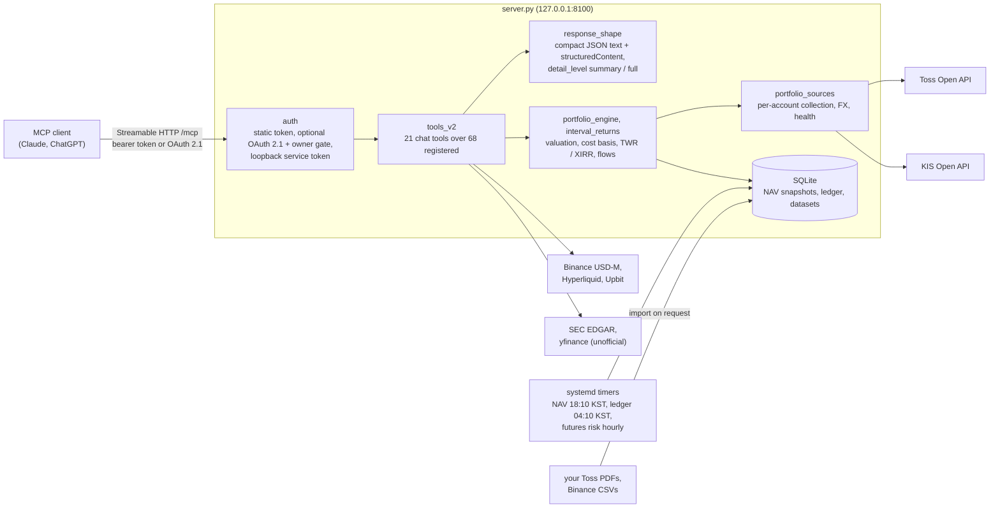

# K-invest

[한국어](README.ko.md)

K-invest is a read-only [MCP](https://modelcontextprotocol.io) server that lets an AI chat client such as Claude or
ChatGPT answer questions about your own brokerage and crypto accounts. It is for individual investors in Korea with
accounts at Toss Securities and/or Korea Investment & Securities (KIS). It puts holdings, period returns, trades and
realized P&L in one place. Every number carries its source and as-of time, and a reason code where data is
incomplete.

You run it on your own machine or server with your own API keys. It sends requests only to the APIs listed below.

## Data sources

| Source | Access | Used for |
|---|---|---|
| Toss Securities Open API | official; your client ID and secret | accounts, holdings, cash, order history, quotes, candles, market calendar, FX |
| KIS Open API | official; your app key and secret | domestic and overseas balances, cash, trade history, quotes |
| SEC EDGAR | official; descriptive `User-Agent` in `SEC_USER_AGENT` | US financials, TTM figures, Form 4 insider trades |
| Yahoo Finance via [yfinance](https://github.com/ranaroussi/yfinance) | **unofficial** | financials and key metrics, dividend calendars, the 10Y Treasury yield, fallback FX. Values are labelled `yfinance`. |
| Binance USD-M futures API | official; read-only API key | futures positions, balances, fills, funding. Public market data needs no key. |
| Hyperliquid info API | official public endpoint; account address only | perp positions, balances, fills, funding |
| Upbit public ticker | official public endpoint | KRW price of USDT/USDC for valuing crypto balances |
| Your own files | local | Toss PDF statements and Binance CSV exports, imported on request |

It does not scrape or log in to any website. An account you do not configure is reported as not configured, and
the other tools keep working.

## Tools

Chat clients see 21 tools. The server registers 68. The other 47 are older, narrower tools that the 21 replace;
they stay callable for scripts and local services.

| Tool | What it returns |
|---|---|
| `get_status` | Connector status: cached service health, live source probes, configured accounts, or the usage guide |
| `get_holdings` | Current positions merged per symbol in native currency and KRW, plus cash |
| `get_portfolio_summary` | Totals across every broker account, by section: totals, exposure, concentration, realized P&L |
| `get_portfolio_returns` | Return for a period: simple return, TWR and XIRR side by side, P&L split, NAV risk statistics |
| `get_transactions` | Trades across every Toss and KIS account, newest first, one page at a time |
| `get_trading_pnl` | Realized P&L under per-account moving-average cost basis, round trips, win rates |
| `get_quote` | Quotes for up to 10 symbols (Toss, falling back to KIS) |
| `get_candles` | OHLCV candles for one stock |
| `get_market_info` | KR/US market sessions and holidays, an FX rate, the 10Y US Treasury yield |
| `get_crypto_market` | Public Binance USD-M market data for one symbol |
| `get_crypto_positions` | Open crypto futures positions and balances (Binance USD-M, Hyperliquid) |
| `get_crypto_account_history` | Your crypto futures fills or funding payments, paged |
| `get_stock_snapshot` | Quote, metrics, analyst consensus and insider data for one stock |
| `get_financials`, `get_key_metrics` | Financial statements and key metrics from yfinance (US, Korea, Japan) |
| `get_sec_financials`, `get_ttm_financials` | SEC annual and quarterly financials, TTM figures (US) |
| `get_insider_trades` | SEC Form 4 insider transactions (US) |
| `snapshot_portfolio_nav` | **Local write.** Stores today's NAV snapshot. The 18:10 KST timer normally does this. |
| `export_portfolio_dataset` | **Local write.** Freezes an auditable copy of the portfolio data and returns it in pages |
| `import_statement` | **Local write.** Imports buy/sell rows from a Toss PDF statement in a private inbox folder into the local ledger, in two steps |

Returns are computed from your own stored data. Where part of the history is missing, for example a deposit that no
API reports, the tool states this with a reason code and marks the figure as an estimate.

## Architecture



The timers in `deploy/` run `scripts/snapshot_nav.py`, `scripts/collect_ledger.py` and
`scripts/snapshot_futures_risk.py` without the server. A return between two dates needs a stored NAV for each date,
so the daily snapshot is what makes period returns possible. Crypto futures are reported separately and are not
part of the portfolio NAV.

## Response size budgets

Every tool result carries one `structuredContent` object and the same object as compact JSON in a single text block
(MCP 2025-06-18). A client that shows the model only the text (claude.ai) and a client that reads
`structuredContent` (ChatGPT) see the same fields.

- `detail_level="summary"` is the default for the large portfolio tools. It moves ID lists, per-day FX tables and
  evidence blocks to `full`, lists each moved path and its item count in `meta.detail.omitted`, and stores repeated
  metadata once under `shared`. Numbers the answer needs, and reason codes that explain a missing value, are never
  moved.
- Summary defaults of `get_portfolio_summary`, `get_portfolio_returns` and `get_holdings` stay at or under 27,000
  bytes on a multi-account test portfolio.
- Every other chat default stays under 30 KiB, including each page of `get_transactions` and
  `get_crypto_account_history`. Pages hold 1–500 rows (default 100). A cursor is rejected if the arguments or the default date window changed.
- `detail_level="full"` returns the complete object.

`tests/test_merge_budget.py`, `tests/test_merge_paging.py` and `tests/test_route_returns_size.py` enforce these
limits.

## Cross-client regression

Before a release, a fixed set of 19 questions is asked in both Claude and ChatGPT against the same running server.
Each answer is graded pass, partial or fail against the tool output it should be based on. Under the owner's
grading rule, ChatGPT may also use its own built-in tools, as long as the portfolio data comes from K-invest.

Latest run, on this release (2026-10-22 21:14 KST, 19 prompts per client):

| Client | Pass | Partial | Fail |
|---|---:|---:|---:|
| Claude | 18 | 1 | 0 |
| ChatGPT | 16 | 3 | 0 |

The offline test suite checks the wire format both clients depend on. The text block must equal
`structuredContent`, and a whole-call failure must set `isError`. The chat catalog, descriptions and schemas are
pinned by hash (`tests/test_tx_wire.py`, `tests/test_merge_catalog.py`, `tests/test_tool_offloop.py`).

## Read-only safety

- There are no order, cancel, transfer or withdrawal tools, and no code calls a broker or exchange write
  endpoint. The only POST requests are OAuth token requests to Toss and KIS and Hyperliquid's read-only `/info`
  endpoint.
- Use read-only keys where the provider offers them (for Binance, no trading and no withdrawals). Hyperliquid
  needs only your public address.
- Three tools write, and only to local files: `snapshot_portfolio_nav`, `export_portfolio_dataset` and
  `import_statement`. Their descriptions tell the model to use them only on an explicit request, and they are
  annotated `readOnlyHint: false`. `import_statement` stores nothing until a second call confirms the preview.
  Every other tool is annotated `readOnlyHint: true`.
- Account numbers in tool output are masked to the last four digits. Credentials are read from the environment,
  files or systemd credentials and are never logged or echoed.
- The server listens on `127.0.0.1` only. If a hosted client needs to reach it, put your own HTTPS reverse proxy in
  front and turn on OAuth with the owner passphrase gate (see `.env.example`).

## Quick start

Requires Python 3.10+ and at least one configured source.

```bash
git clone <this repository> k-invest && cd k-invest
python -m venv .venv && . .venv/bin/activate
pip install -r requirements.txt
pip install pytest pytest-asyncio exceptiongroup ruff
python -m pytest tests/ -q          # offline; no network, keys or accounts needed

cp .env.example .env                # fill in the sources you use
echo "MCP_AUTH_TOKEN=$(python -c 'import secrets; print(secrets.token_urlsafe(32))')" >> .env
python server.py                    # serves http://127.0.0.1:8100/mcp
```

Point an MCP client at `http://127.0.0.1:8100/mcp` with the header `Authorization: Bearer <MCP_AUTH_TOKEN>`, then
call `get_status` to check the setup. The server refuses to start without `MCP_AUTH_TOKEN`.

For a server install, `deploy/` has systemd units for the server and the three timers (replace `youruser` and the
paths). Optional settings, all described in `.env.example`:

| Variable | Effect |
|---|---|
| `TOSS_CREDS_FILE`, `KIS_ACCOUNTS_JSON` | several Toss or KIS accounts |
| `BINANCE_FUTURES_API_KEY_FILE`, `BINANCE_FUTURES_SIGNING_KEY_FILE`, `HYPERLIQUID_ACCOUNT_ADDRESSES` | crypto futures accounts |
| `MCP_OAUTH_ENABLED`, `MCP_PUBLIC_URL`, `OWNER_GATE_REDIRECT_ORIGINS` | OAuth 2.1 with dynamic client registration for hosted clients. Create the passphrase hash with `python -m owner_gate hash`. |
| `KINVEST_PRODUCT_MAP_FILE` | look-through from leveraged or single-stock ETFs to their underlying (format in `product_map.example.json`). Without it every product counts as its own exposure. |
| `KINVEST_STATEMENT_INBOX` | folder of Toss PDF statements for `import_statement` |
| `KINVEST_PORTFOLIO_DB`, `KINVEST_CACHE_DIR` | where the SQLite store and caches live |

## Tests

`python -m pytest tests/ -q` runs the whole suite offline against synthetic data and mocked HTTP. A few tests
compare against files from older releases in the git history. In a clone without that history they are skipped and
the reason is printed.

## License and support

MIT, see [LICENSE](LICENSE).

This is a personal project published as-is. No support, maintenance or answers to issues are promised. It is not
affiliated with Toss Securities, Korea Investment & Securities, Binance, Hyperliquid or Upbit. Figures are only as
good as the data the APIs return, and yfinance is unofficial. Nothing this software outputs is investment advice.
